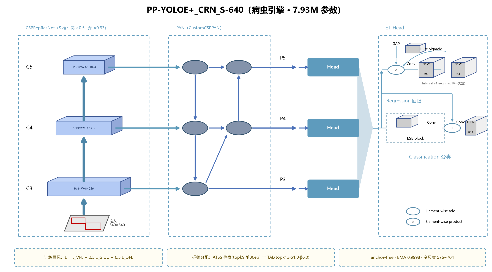
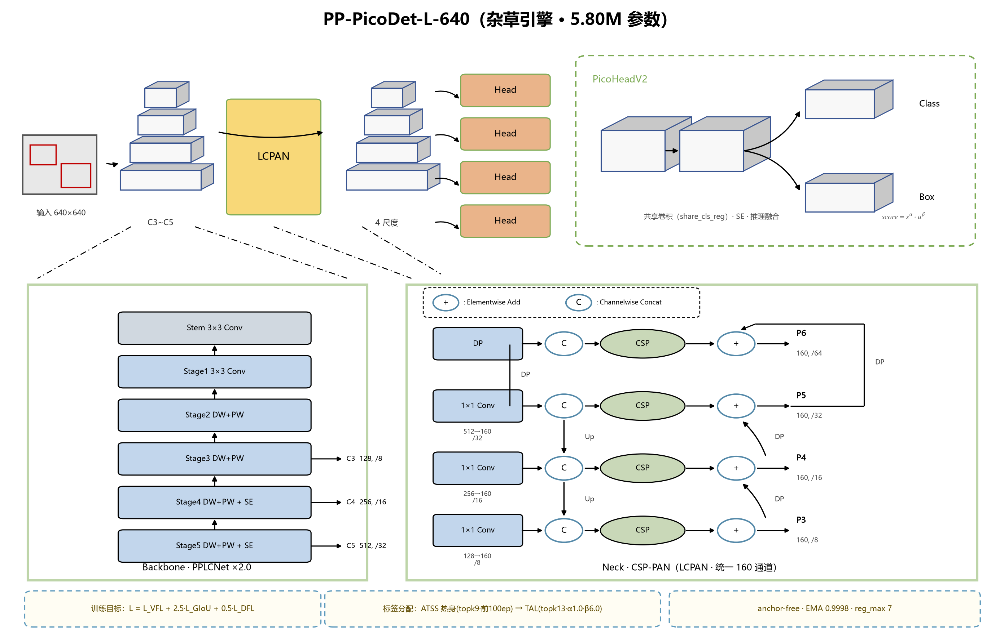

# HuiyanAgri 慧眼护农

**双引擎农作物有害生物检测系统**：一张图同时检测 **14 类病虫害**（PP-YOLOE+_S）与 **12 类棉田杂草**（PP-PicoDet-L），附防治/防除建议卡与农事问答助手；提供 **Web 演示**与**安卓离线 App** 两种形态。

Dual-engine crop protection system: PP-YOLOE+_S (pest, 14 classes) + PP-PicoDet-L (weed, 12 classes), with control-advice cards and an LLM-powered Q&A assistant. Web demo + offline Android app.

## 模型与结果 Models & Results

| 模型 | 任务 | 参数量 | 体积 | mAP50 | CPU 延迟 |
|---|---|---|---|---|---|
| PP-YOLOE+_CRN_S-640 | 病虫害（14 类） | 7.93 M | 30.3 MB | 0.648（val，部署链路） | 0.214 s/图（全链路） |
| S-640 · INT8（QAT） | 病虫害（量化） | 7.93 M | 7.87 MB（−74%） | 0.639 | —（需 INT8 运行时） |
| PP-PicoDet-L-640 | 棉田杂草（12 类） | 5.80 M | 22.5 MB | **0.9646**（test，随机划分） | 0.046 s/图 |

> 口径说明：病虫为 val（1,324 图）导出部署链路 COCOeval；杂草为 test（848 图）导出部署链路，分层划分口径 0.9156；延迟为 MKLDNN、4 线程、640×640 实测。完整评测（逐类 AP、校准 ECE 0.0546、误报结构、消融与融合证伪）见 `docs/`。

<p align="center">
  
  
</p>

两个引擎共享同一套训练目标（VarifocalLoss + GIoU + DFL、TaskAlignedAssigner），按任务难度差异化骨干容量——"统一范式、任务分治"。

## 仓库结构 Repository Layout

```
HuiyanAgri/
├── configs/                 # 训练配置（自包含，可直接训练）
│   ├── ppyoloe_plus_crn_s_100e_agripest.yml      # 病虫主模型
│   ├── ppyoloe_plus_crn_s_qat_agripest.yml       # 病虫 QAT INT8（--slim_config）
│   ├── ppyoloe_plus_crn_m_300e_agripest.yml      # 病虫容量消融（23.5M，零增益）
│   ├── picodet_l_640_agriweed.yml                # 杂草引擎
│   └── picodet_l_640_agripest.yml                # 病虫前代基线（对照）
├── scripts/
│   ├── eval/                # 评测脚本（mAP/逐类/分层/校准/误报/双口径终评）
│   └── data_preparation/    # CottonWeedDet12: VIA→COCO + 弱类过采样 + 640 预缩缓存
├── web/                     # Gradio 演示（四 Tab：综合/病虫/杂草/农事问答）
├── android/                 # 安卓 App 源码（慧眼护田，Paddle-Lite 离线推理）
└── docs/                    # 模型介绍 / 评测汇总 / 公式手册 / 架构图
```

> 模型权重与数据集不入库：权重见 Releases；数据集为第三方许可（见致谢）。

## 快速开始 Quick Start

### Web 演示

```bash
# 1) 环境：PaddlePaddle 2.6.x + PaddleDetection 2.9（deploy/python）+ gradio + pillow
# 2) 从 Releases 下载两个部署模型，分别放入 web/model_pest 与 web/model_weed
# 3) 启动（Windows 用 set，Linux 用 export 设 PaddleDetection 路径与可选的智谱 key）
set ZHIPU_API_KEY=你的key      # 可选：农事问答 Tab；不设也不影响三个检测 Tab
python web/app.py              # 浏览器自动打开 http://127.0.0.1:7862
```

检测全程本地推理；农事问答 Tab 由智谱 GLM 驱动（`ZHIPU_API_KEY` 环境变量注入，源码不含任何密钥），内置 26 类知识库并自动联动最近一次检测结果。

### 安卓 App（慧眼护田）

`android/` 为完整 Gradle 工程（Paddle-Lite 推理，检测完全离线）：

```bash
cd android
# 模型文件（*.nb）从 Releases 下载后放入 app/src/main/assets/models/
gradle assembleDebug           # 或用 Android Studio 打开构建
```

### 训练复现

```bash
# 病虫引擎（PaddleDetection 根目录执行；数据集路径按 yml 内 dataset_dir 调整）
python tools/train.py -c configs/ppyoloe_plus_crn_s_100e_agripest.yml --eval

# 杂草引擎（先跑 scripts/data_preparation 三个脚本准备数据）
python scripts/data_preparation/convert_to_coco.py     # VIA→COCO + 双轨划分（强校验 5648/9370）
python scripts/data_preparation/balance_train.py       # 弱类过采样 16.9:1 → 5.3:1
python scripts/data_preparation/build_640_cache.py     # 640 预缩缓存（GPU 利用率 9%→21 img/s）
python tools/train.py -c configs/picodet_l_640_agriweed.yml --eval

# QAT INT8（病虫；需 paddleslim）
python tools/train.py -c configs/ppyoloe_plus_crn_s_100e_agripest.yml \
    --slim_config configs/ppyoloe_plus_crn_s_qat_agripest.yml --eval \
    -o save_dir=output/ppyoloe_s_qat weights=output/ppyoloe_s_qat/best_model
```

评测脚本（`scripts/eval/`）内为本机绝对路径，使用前请改为你的模型/数据路径。

## 关键实证 Findings

- **受控架构对照**：同数据同超参下 PicoDet-L → PP-YOLOE+_S **+5.2 mAP**，为全项目唯一超 bootstrap 噪声（±0.04）的模型侧变更；23.5M 的 M 档容量消融零增益——瓶颈在数据不在容量。
- **空图负样本增强**：训练集混入 15% 空图，健康叶误报 **1.8 → 0.5 个/图**。
- **量化正反对照**：病虫 QAT INT8 体积 −74%、mAP 仅 −1.1；杂草 PTQ 灾难性崩坏（0.9646→0.209，两轮校准一致）——轻量检测头的解码路径对纯训练后量化敏感，**量化请走 QAT**。
- **置信度校准**：ECE 0.0546（N=235,889），≥0.80 档精确率 0.958——模型分数可直接作为业务阈值。

## 致谢与数据许可 Acknowledgements

- 检测框架：[PaddleDetection](https://github.com/PaddlePaddle/PaddleDetection)（PP-YOLOE+、PP-PicoDet）与 [PaddleSlim](https://github.com/PaddlePaddle/PaddleSlim)（QAT）
- 数据集（均不入库，仅作研究用途）：病虫侧基于 PlantDoc / IP102 / PlantVillage；杂草侧为 [CottonWeedDet12](https://zenodo.org/records/7535814)（CC BY-NC 4.0）
- 农事问答：[智谱 GLM](https://open.bigmodel.cn/)

## License

代码以 MIT 许可发布（见 LICENSE）。防治与用药建议仅供学习参考，实际生产请遵循当地植保部门指导。
